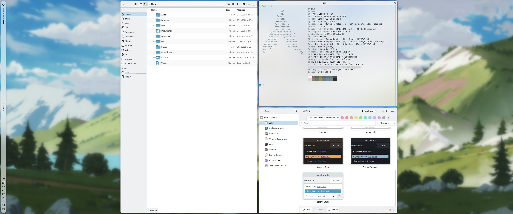
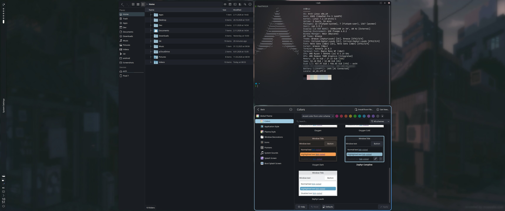
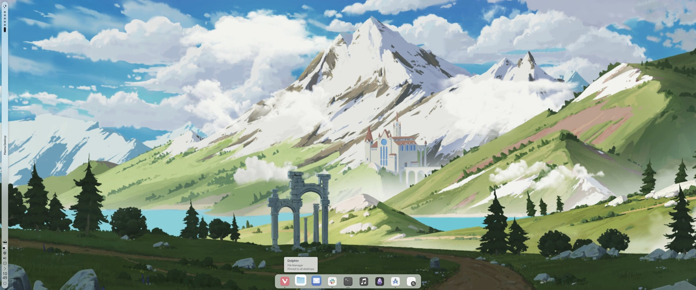

# Zephyr for Plasma 6

[](#credits-and-license)
[](https://ko-fi.com/divinae4535)

**A calm, near-monochrome desktop, light by day and dark by night.** Two KDE Plasma 6 themes from
the [Compline](https://complinetheme.com) palette: **Zephyr Lauds** (light) and **Zephyr Compline**
(dark). Colour schemes, a translucent Plasma style, global themes, muted icons, terminal themes, and
small scripts that keep the apps Plasma can't reach in step when it switches between the two.

| | |
| --- | --- |
|  |  |
| Zephyr Lauds | Zephyr Compline |

## What's in it

| | Lauds (light) | Compline (dark) |
| --- | --- | --- |
| **Colour scheme** | `ZephyrLauds` | `ZephyrCompline` |
| **Plasma style** (panels, popups: translucent, Breeze's shapes) | `zephyr-light` | `zephyr-dark` |
| **Global theme** (all of it at once, Breeze widgets and window frames) | Zephyr Lauds | Zephyr Compline |
| **Icons**: [Colloid](https://github.com/vinceliuice/Colloid-icon-theme), desaturated to half | Colloid-Zephyr-Lauds | Colloid-Zephyr-Compline |
| **Konsole** colours and profile | Zephyr Lauds | Zephyr Compline |
| **Yakuake** skin | Zephyr Lauds | Zephyr Compline |
| **Vivaldi** theme (`apps/vivaldi/`, import the `.zip`) | Zephyr Lauds | Zephyr Compline |
| **Slack** sidebar theme (`apps/slack/zephyr-themes.md`) | Zephyr Lauds | Zephyr Compline |

No wallpaper ships with it; `scripts/gen-zephyr-wallpaper.sh` mutes one you have to match (see
[Tools](#tools)).

## Install

```sh
git clone https://github.com/divinae/zephyr-theme.git
cd zephyr-theme
./install.sh          # the themes, into ~/.local/share (no root)
./install.sh --sync   # and the light/dark sync service (below)
```

Then pick **Zephyr Lauds** or **Zephyr Compline** in System Settings > Colors & Themes > Global
Theme. For the icons, install [Colloid](https://github.com/vinceliuice/Colloid-icon-theme) first
(its Light and Dark variants); the install script then makes the muted copies from it.
`./install.sh --uninstall` takes it all out again.

To switch by itself with the time of day, set System Settings > Colors & Themes > Global Theme >
"Switch automatically" to Zephyr Lauds for day and Zephyr Compline for night.

## Light and dark, everywhere

Plasma switches its own colours, but some apps keep theirs. `./install.sh --sync` starts
`zephyr-theme-sync.service`: one watcher (`scripts/theme-watch.sh`) listens for the scheme to
change, through the desktop portal, and passes light or dark on to:

- **Konsole and Yakuake** (`konsole-theme-sync.sh`): the matching profile and skin, for new
  windows and the ones already open (live sessions need `EnableSecuritySensitiveDBusAPI=true` in
  `konsolerc` and `yakuakerc`, see the script);
- **System Monitor widgets** (`sysmon-color-sync.sh`): the CPU and memory bars, which keep a
  fixed colour of their own, repainted in the scheme's text colour so they don't vanish;
- **Slack's tray icon** (`slack-tray-theme.sh`, the Flatpak): Colloid's icon in place of Slack's
  own; it repacks Slack's `app.asar`, with `@electron/asar` from `scripts/asar-tool/`
  (`npm ci` there first).

Each is a small script you can run by hand too (`scripts/konsole-theme-sync.sh dark`).

## My setup



The previews are my desktop, and the global themes bring along its layout (System Settings asks
before it changes your panels): a floating panel on the left and a dock at the bottom. On top of
Zephyr, it's:

**On the panels**
- [Glance](https://github.com/divinae/glance-plasmoid): the window's menus, music, notifications,
  meetings, controls and a focus timer, in a vertical strip with a drawer (mine)
- [Taskline](https://github.com/divinae/taskline-plasmoid) (my fork of Fancy Tasks NG by Vitaliy
  Elin): the dock's task manager, with live window previews, media controls on the window that
  actually plays, unread badges, and attention signals that don't nag
- [Event Calendar NG](https://github.com/divinae/event-calendar-ng-plasmoid): the clock and the
  calendar (my redesign of Event Calendar)
- [kara](https://github.com/dhruv8sh/kara) by Dhruvesh Surolia: the virtual desktops
- [Apdatifier](https://github.com/exequtic/apdatifier) by Evgeny Kazantsev: updates
- CatWalk by Yuri Saurov: a cat that runs as fast as the CPU works
- Plasma's own: the launcher, System Monitor, the system tray

**Windows**
- [Karousel](https://github.com/peterfajdiga/karousel) by Peter Fajdiga: scrollable tiling, windows
  in columns on an endless strip
- [Karousel Overview](https://github.com/divinae/karousel-overview) (mine): a Niri-style overview
  for it, every desktop as a strip of its windows, off-screen columns too; drag windows between
  them, stack them, search ([KDE Store](https://store.kde.org/p/2379855/))
- [KDE Rounded Corners](https://github.com/matinlotfali/KDE-Rounded-Corners) by Matin Lotfaliei:
  rounded corners and their outline
- Bouncing Windows by bitran0, Geometry Change by Peter Fajdiga, and Kinetic's fading popups: the
  animations
- KWin's blur and contrast for the translucent panels and popups

**The rest**
- Breeze widgets, window frames and cursors
- Noto Sans for the interface, Maple Mono NF in the terminal (JetBrainsMono Nerd Font for the
  fixed-width font)
- my [Fokus](https://github.com/divinae/focus-plasmoid) and
  [Shift](https://github.com/divinae/shift-plasmoid) live inside Glance

## Tools

The themes are built from small scripts, so a change goes through them, not by hand:

- `scripts/gen-compline-colors.py`: the two colour schemes, from the palette and a role mapping
  (`python3 -I scripts/gen-compline-colors.py plasma/color-schemes`)
- `scripts/gen-muted-icons.py`: the muted Colloid copies (`--src Colloid-Light --name
  Colloid-Zephyr-Lauds --saturation 0.5`)
- `scripts/gen-zephyr-wallpaper.sh`: any Plasma wallpaper package, muted to match (half the
  saturation, and a tone curve for each variant)
- `scripts/make-lnf-previews.sh`: the global themes' preview images, from the screen

## Credits and license

- The palette is [Compline](https://github.com/jblais493/compline) (and its light Lauds) by
  [Joshua Blais](https://joshblais.com), GPL-3.0; the colour schemes take it with tweaks of their
  own (buttons, headers, contrast, Breeze's neutrals for Lauds).
- The icons are made from [Colloid](https://github.com/vinceliuice/Colloid-icon-theme) by
  Vince Liuice, GPL-3.0; only the generator ships here.
- The Plasma style keeps Breeze's shapes (LGPL).
- The Yakuake skins are recoloured from **Slate** by TheBigWazz (KDE Store).

Zephyr itself is GPL-3.0, see `LICENSE`. If it's useful to you, you can buy me a coffee on
[Ko-fi](https://ko-fi.com/divinae4535).
